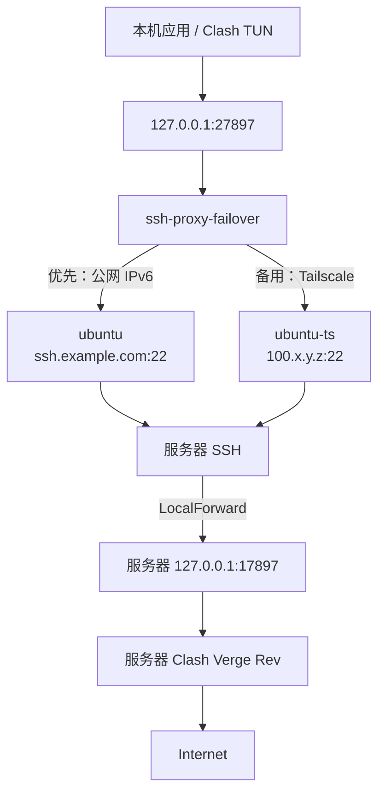

# 前言

此前我已经通过 
将服务器上的 Clash 代理端口映射到本机 `127.0.0.1:27897`，并在

中将这个本地端口作为 TUN 模式的上游。

原来的 SSH 连接使用公网 IPv6：本机通过 DDNS 域名
`ssh.example.com` 直接连接服务器。这条链路延迟低，也不需要经过额外的
组网服务，因此仍然是首选。不过公网 IPv6 会受到校园网、运营商路由、DDNS
更新或服务器防火墙等因素影响；任意一处出现问题，SSH 隧道就会断开，远程
代理也无法使用。

为了避免只依赖一条网络路径，我在原方案上增加了 Tailscale 作为备用链路：
公网 IPv6 可用时优先直连；直连失败或中断时，自动改用 Tailscale 虚拟网络中
的地址重新建立相同的 SSH LocalForward。无论当前实际走哪条链路，本地应用
始终只访问同一个 `127.0.0.1:27897`。



本文的备用方案是 **在 Tailscale 网络中运行普通 SSH**，即连接服务器的
Tailscale 地址 `100.x.y.z:22`；并没有启用 `tailscale ssh` 提供的
Tailscale SSH 服务。两者的认证与配置方式不同，不要混淆。



# 1. Tailscale 是什么

Tailscale 是基于 WireGuard 的设备组网工具。登录同一个 Tailnet 的设备会获得
一组私有地址，并尝试在设备之间建立点对点加密连接；即使无法直连，也可以在
其协调机制的帮助下维持可用连接。

对这里的场景来说，Tailscale 的价值不在于替代公网 IPv6，而是提供一条不依赖
DDNS、IPv6 入站策略和公网路由质量的备用到达路径。服务器和本机均已加入同一
Tailnet 后，本机可以直接用服务器的 Tailscale IP 访问其 22 端口。

```bash
# 两端确认 Tailscale 已登录且在线
tailscale status

# 本机测试备用 SSH 链路
ssh ubuntu-ts
```

Tailscale 本身解决的是设备之间的私有网络可达性；SSH 密钥登录、服务器 SSH
配置，以及 Clash 仅绑定 `127.0.0.1:17897` 的安全边界仍然保留不变。

# 2. 冗余链路架构

两条 SSH 连接的远端目标相同：都是服务器本机的
`127.0.0.1:17897`，也就是服务器 Clash Verge Rev 的 mixed-port。不同之处
只在于到达服务器 SSH 端口的路径。



主、备切换不改变本地监听地址，因此 
仍然使用下面这个 SOCKS5 上游即可：

```yaml
proxies:
  - name: SSH-Remote-Clash
    type: socks5
    server: 127.0.0.1
    port: 27897
    udp: false
```

SSH LocalForward 只能转发 TCP，故这里仍需保留 `udp: false`。

# 3. 配置两个 SSH 主机

在 `~/.ssh/config` 中保留原有公网 IPv6 主机 `ubuntu`，并增加使用 Tailscale
地址的 `ubuntu-ts`：

下面的 `ssh.example.com`、`100.x.y.z` 和 `用户名` 均为示例。配置前必须
分别替换为自己的 DDNS 域名、服务器 Tailscale 地址和 SSH 登录用户。

```text ~/.ssh/config
# 主链路：DDNS 解析到服务器的公网 IPv6
Host ubuntu
    HostName ssh.example.com
    User 用户名
    IdentityFile ~/.ssh/id_ed25519
    Port 22

# 备用链路：同一台服务器在 Tailscale 网络中的地址
Host ubuntu-ts
    HostName 100.x.y.z
    User 用户名
    HostKeyAlias ssh.example.com
    IdentityFile ~/.ssh/id_ed25519
    Port 22
    ConnectTimeout 5
    ConnectionAttempts 1
    BatchMode yes
```

`HostKeyAlias ssh.example.com` 很重要。两个别名实际上都指向同一台服务器，
其 SSH 主机密钥也应相同。通过这个选项，`ubuntu-ts` 会沿用以
`ssh.example.com` 保存的主机密钥记录，避免因为访问地址从域名变为
Tailscale IP 而产生额外的 `known_hosts` 条目或主机身份确认提示。

`ConnectTimeout 5`、`ConnectionAttempts 1` 和 `BatchMode yes` 则让备用
连接在不可用时快速、非交互式地失败，避免服务卡在密码或主机确认提示上。

# 4. 自动切换脚本

创建 `~/.local/bin/ssh-proxy-failover`：

```bash ~/.local/bin/ssh-proxy-failover
#!/usr/bin/env bash
set -uo pipefail

# Primary: IPv6 SSH
# Backup:  SSH over Tailscale
readonly LOCAL_PORT=27897
readonly REMOTE_HOST=127.0.0.1
readonly REMOTE_PORT=17897
readonly RETRY_INTERVAL=5

readonly -a SSH_HOSTS=(
    ubuntu
    ubuntu-ts
)

readonly -a SSH_OPTS=(
    -N
    -T
    -o BatchMode=yes
    -o ConnectTimeout=5
    -o ConnectionAttempts=1
    -o ExitOnForwardFailure=yes
    -o ServerAliveInterval=15
    -o ServerAliveCountMax=3
    -o TCPKeepAlive=yes
)

log() {
    printf '[%s] %s\n' "$(date '+%F %T')" "$*"
}

cleanup() {
    log "Stopping SSH proxy failover"
    exit 0
}

trap cleanup SIGINT SIGTERM

log "SSH proxy failover started"
log "Forward: 127.0.0.1:${LOCAL_PORT} -> ${REMOTE_HOST}:${REMOTE_PORT}"

while true; do
    for host in "${SSH_HOSTS[@]}"; do
        log "Connecting via ${host}..."

        ssh "${SSH_OPTS[@]}" \
            -L "127.0.0.1:${LOCAL_PORT}:${REMOTE_HOST}:${REMOTE_PORT}" \
            "$host"

        rc=$?
        log "Connection to ${host} ended (exit=${rc})"
    done

    log "Retrying in ${RETRY_INTERVAL}s..."
    sleep "$RETRY_INTERVAL"
done
```

赋予执行权限：

```bash
chmod +x ~/.local/bin/ssh-proxy-failover
```

脚本按 `SSH_HOSTS` 的顺序工作：

1. 首先连接 `ubuntu`，即经过 `ssh.example.com` 的公网 IPv6 路径；只要它稳定，脚本便持续保持该隧道。
2. 主链路无法建立，或后续断开时，`ssh` 退出，脚本立即尝试 `ubuntu-ts`，即 `100.x.y.z` 的 Tailscale 路径。
3. 两条链路都不可用时，等待 5 秒后再从主链路开始尝试。因此公网 IPv6 恢复后会重新成为优先路径。

`ExitOnForwardFailure=yes` 能避免 SSH 虽然连上、但本地 `27897` 端口未成功监听
时仍被误判为服务正常。`ServerAliveInterval` 与 `ServerAliveCountMax` 则用于
发现长时间无响应的连接，触发切换。

# 5. 使用 Systemd 用户服务守护

将原先直接执行单个 `ssh` 的服务替换为执行切换脚本：

```ini ~/.config/systemd/user/ssh-proxy.service
[Unit]
Description=SSH Proxy Failover (IPv6/Tailscale)
Wants=network-online.target
After=network-online.target

[Service]
Type=simple
ExecStart=%h/.local/bin/ssh-proxy-failover
Restart=always
RestartSec=5
KillMode=control-group

[Install]
WantedBy=default.target
```

重新加载并启动：

```bash
systemctl --user daemon-reload
systemctl --user enable --now ssh-proxy.service
```

查看当前服务状态和切换日志：

```bash
systemctl --user status ssh-proxy.service --no-pager
journalctl --user -u ssh-proxy.service -f
```

确认本地转发端口已经建立：

```bash
ss -lnt | grep 27897
```

正常情况下，日志会先显示 `Connecting via ubuntu...`。若公网 IPv6 暂时无法
使用，应依次看到 `Connection to ubuntu ended`、`Connecting via ubuntu-ts...`，
而 `27897` 会继续作为本地代理入口存在。

# 6. 注意事项

## 6.1 Tailscale 不是公网 IPv6 的替代品

公网 IPv6 直连通常路径更短，也减少了额外依赖，因此本方案只把 Tailscale 放在
备用位置。`SSH_HOSTS` 的先后顺序就是优先级；如果你的网络环境恰好让 Tailscale
更稳定，也可以交换 `ubuntu` 与 `ubuntu-ts` 的顺序。

## 6.2 保持 SSH 服务器直连

如果本机还启用了 Clash Verge Rev 的 TUN 模式，SSH 服务器的公网域名和
Tailscale 地址都不应被送回这条代理隧道，否则可能形成循环。公网主机可继续
按上一篇文章对 `ssh.example.com` 设置 `DIRECT` 规则；Tailscale 的
`100.64.0.0/10` 地址范围也应保持直连：

```yaml
rules:
  - DOMAIN,ssh.example.com,DIRECT
  - IP-CIDR,100.64.0.0/10,DIRECT,no-resolve
```

把这些规则放在最终的 `MATCH,PROXY` 之前。

## 6.3 备用链路也需要安全边界

Tailscale 网络降低了暴露公网端口的需求，但不应因此放松 SSH 安全设置。仍应使用
密钥认证、禁用不必要的密码登录，并控制 Tailnet 成员和 ACL 权限。服务器上的
Clash mixed-port 依旧只绑定在 `127.0.0.1:17897`，这样即使有新的网络入口，
代理端口本身也不会直接对 Tailnet 或公网开放。

# 总结

这个改动没有改变原有的代理结构，只是在到达服务器 SSH 的位置增加了第二条路：
公网 IPv6/DDNS 为主，Tailscale 为备。通过脚本按优先级维护隧道、本地固定暴露
`127.0.0.1:27897`，上层的终端代理和 Clash TUN 配置都无需感知实际链路的变化。

对于已经依赖 SSH 隧道承载远程代理的场景，这种做法能以较小的改动降低单条网络
路径故障带来的影响。
